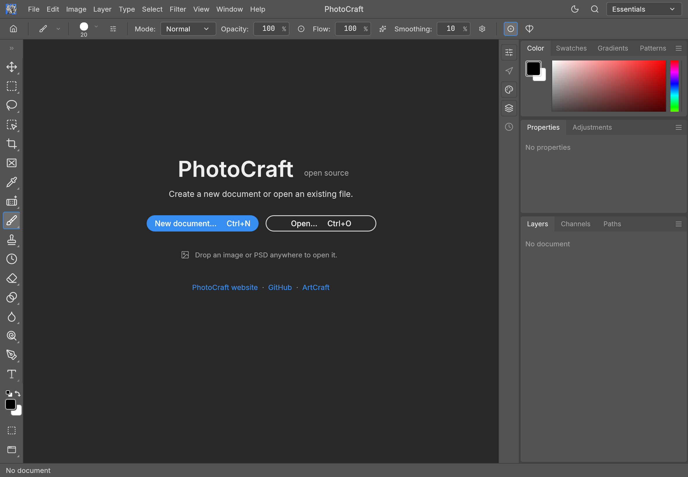

# PhotoCraft for iPadOS (fork)

<p align="center">
  
  <br>
  <sub>PhotoCraft on iPadOS, in landscape (iPad Air 11-inch simulator).</sub>
</p>

This fork exists only for the **iPadOS port** of PhotoCraft, an open-source, clean-room image editor
written in Rust. To learn about the project itself (features, file formats, desktop and web builds,
downloads, the other Crafting Apps, contributing), read the upstream README:
**[storytold/photocraft](https://github.com/storytold/photocraft#readme)**.

## What this fork adds

- **`apps/photocraft-ios`**: a Rust static-library runner (UIKit single-scene delegate, Metal-only
  wgpu surface, native document pickers, managed document snapshots with write-back bookmarks,
  PNG clipboard, atomic preferences, crash recovery, Apple Pencil input). See its
  [README](apps/photocraft-ios/README.md).
- **`packaging/ios`**: the Xcode project that links the library into an iPad app bundle, with
  validation tests. See its [README](packaging/ios/README.md).
- **`cargo xtask ios`**: build, install and launch on the Simulator or a physical iPad
  (`--sim`, `--device --device-id <id> --team <id> [--bundle-id <dev id>]`).
- **Shared changes**: a painted tool-cursor fallback on iOS (winit ignores OS cursor setters there).
- **Interface changes for touch**: the default Light theme is Pro (Light Gray), so Light and Dark are the same
  Pro layout in two brightness levels; the title-bar appearance button flips Light and Dark in one tap (no
  Follow System state, no menu; Preferences keeps Auto); the right dock folds to its icon rail with the rail's
  chevron (Window > Collapse Panels to Icons), and tapping a rail icon opens it again. Saved settings keep an
  earlier Light theme choice: pick Pro (Light Gray) once in Preferences > Interface to match.
- **Docs**: [hardware parity](docs/hardware-parity.md) has an iPadOS column; the port plan, tickets
  and validation reports are in [`plans/`](plans/README.md).

## Status

Verified on an iPad Air 13-inch M3 running iPadOS 27.0 (Debug build): signed install and launch,
Metal rendering, pressure-dependent Apple Pencil strokes, Pencil hover cursor, and
new → save → reopen → edit → save. Tilt and palm rejection passed provisionally; double-tap is
deferred. **Not yet verified on hardware:** pinch, pan and rotate gestures, multitasking and
resizing, provider write-back after a restart, layered PSD import, background recovery, Release
builds. This is not a full hardware sign-off.

## Build and run

Requires macOS with Xcode and the Rust targets `aarch64-apple-ios`, `aarch64-apple-ios-sim`
and `x86_64-apple-ios`.

```sh
cargo xtask ios --sim          # build, boot, install and launch on the iPad simulator
cargo xtask ios --device --device-id <udid> --team <team id> --bundle-id <your.dev.bundle.id>
cargo test -p photocraft-ios --lib
python3 -m unittest discover -s packaging/ios/tests -v
```

Contributor rules (Rust only, never panic, layering, tests) are in [`AGENTS.md`](AGENTS.md).

## License and attribution

Dual-licensed MIT OR Apache-2.0, as upstream. Third-party and original assets are listed in
[`ATTRIBUTION.md`](ATTRIBUTION.md).
